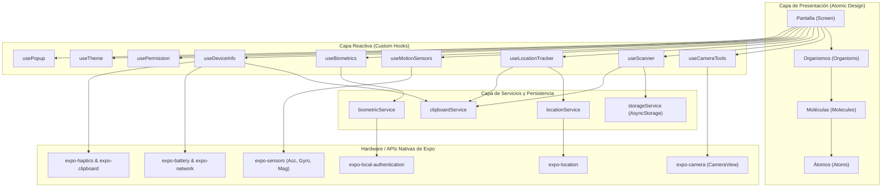

# Arquitectura del Sistema y Atomic Design

Este documento describe la arquitectura interna de software implementada en **Sensores Hub**, los principios de diseño atómico y el flujo de comunicación por capas entre la interfaz gráfica y los controladores nativos del dispositivo.

---

## 1. Diagrama de Flujo por Capas (UI → Hook → Service → API Nativa)

La aplicación aplica una estricta separación de responsabilidades: los componentes de la interfaz de usuario nunca acceden directamente a las APIs del sistema operativo. Toda interacción pasa por Hooks reactivos y Servicios utilitarios.



---

## 2. Metodología Atomic Design

La estructura del código divide los componentes en cuatro niveles jerárquicos independientes:

### 2.1. Átomos (`/scripts/components/atoms`)
Son los bloques de construcción más pequeños e indivisibles. No tienen dependencias de lógica de negocio:
- **`Text`**: Tipografía estandarizada según variantes del tema (`caption`, `body`, `title`, `headline`).
- **`Icon`**: Envoltorio tipado sobre `Ionicons` con tamaño y color vinculados al tema.
- **`Button`**: Botón táctil con área mínima garantizada de 44px, estados de carga y variantes visuales.
- **`Spinner`**: Indicador de progreso de actividad nativo.
- **`Badge`**: Distintivo visual para estados de permisos (`Concedido`, `Denegado`, `Pendiente`).

### 2.2. Moléculas (`/scripts/components/molecules`)
Combinan átomos simples para construir elementos funcionales reutilizables:
- **`DataRow`**: Fila con etiqueta, valor formateado, icono y botón de copiado al portapapeles.
- **`SensorValue`**: Indicador numérico de eje sensorial con barra visual centrada de balance.
- **`PermissionBanner`**: Banner que describe por qué se requiere un permiso y ofrece botones de acción.
- **`ThemeToggle`**: Selector de modo de tema (Claro / Oscuro / Sistema).
- **`FeatureCard`**: Tarjeta interactiva de acceso a las herramientas en el Dashboard.

### 2.3. Organismos (`/scripts/components/organisms`)
Estructuras complejas compuestas por moléculas y átomos que gestionan secciones completas:
- **`Header`**: Barra superior de la pantalla con título descriptivo y alternador rápido de tema.
- **`SensorPanel`**: Panel de lectura para acelerómetro, giroscopio o magnetómetro (ejes X, Y, Z).
- **`CameraControls`**: Barra flotante de captura fotográfica, conmutación de lente y linterna.
- **`HistoryList`**: Lista de códigos escaneados con opción de vaciado y selección.
- **`Sidebar`**: Barra lateral de navegación fija para ordenadores y pantallas grandes (>= 992px).
- **`TabBar`**: Barra inferior de pestañas ergonómica para dispositivos móviles.

### 2.4. Pantallas (`/scripts/screens`)
Coordinan organismos y conectan los datos provistos por los hooks de hardware:
- No contienen lógica de hardware cruda.
- Se limitan a orquestar el flujo visual y presentar los estados reactivos.

---

## 3. Manejo Global de Retroalimentación (Sin `alert`)

Se implementó el patrón **Context + Portal Modal** mediante `PopupContext` y `PopupModal`:
- Prohibición estricta de `alert()`, `Alert.alert()` o llamadas sincrónicas de navegador.
- Toda notificación o error se invoca mediante:
```typescript
const { showPopup } = usePopup();

showPopup({
  type: 'success', // 'success' | 'error' | 'warning' | 'info'
  title: 'Operación Exitosa',
  message: 'Detalle informativo para el usuario...',
  actions: [
    { label: 'Aceptar', variant: 'primary', onPress: () => {} }
  ]
});
```
- Admite cierre táctil al fondo (dismissible) y animaciones nativas fluidas.
