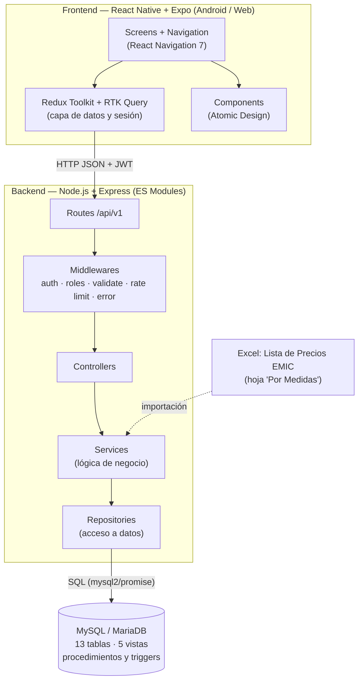
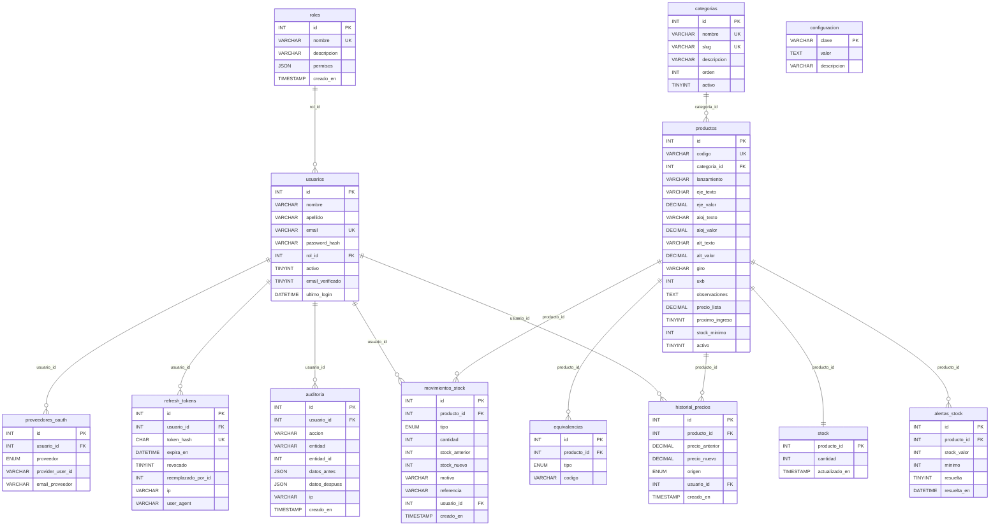
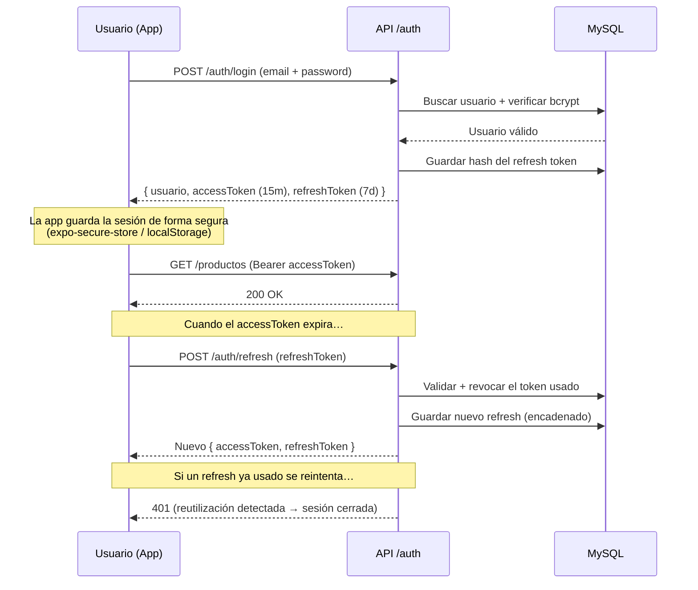
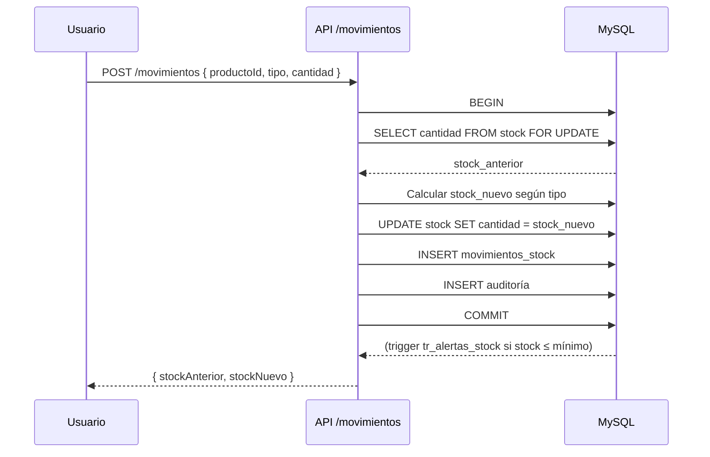

# Diagramas — Sistema de Control de Stock (Retenes EMIC)

Diagramas de referencia del proyecto: **modelo entidad-relación**, **arquitectura de capas** y
**flujo de autenticación**. Se escriben en [Mermaid](https://mermaid.js.org/) y se renderizan
automáticamente en visores compatibles (GitHub, VS Code con extensión Mermaid, etc.).

---

## 1. Arquitectura general

Vista de tres capas: **frontend multiplataforma** (Expo), **backend** (API REST por capas) y
**base de datos** (MySQL).

---

## 2. Modelo entidad-relación

### 2.1 Diagrama ER

### 2.2 Resumen de tablas

| Tabla | Descripción |
|-------|-------------|
| `roles` | Roles del sistema y su lista de permisos (JSON). |
| `usuarios` | Usuarios con credenciales (bcrypt) y rol. |
| `proveedores_oauth` | Identidades de Google / Facebook / GitHub vinculadas a un usuario. |
| `refresh_tokens` | Refresh tokens hasheados (rotación y revocación). |
| `categorias` | Categorías / secciones del catálogo. |
| `productos` | Catálogo: código, medidas (eje/aloj/alt), giro, precio, stock mínimo. |
| `equivalencias` | Códigos equivalentes OEM / A / S por producto. |
| `stock` | Existencias actuales (1 fila por producto). |
| `movimientos_stock` | Historial de ingresos, egresos y ajustes. |
| `historial_precios` | Cambios de precio con origen y usuario. |
| `alertas_stock` | Alertas generadas por stock bajo el mínimo. |
| `auditoria` | Bitácora de operaciones (quién, qué, cuándo). |
| `configuracion` | Parámetros generales (clave-valor). |

### 2.3 Vistas

| Vista | Uso |
|-------|-----|
| `v_stock_actual` | Producto + categoría + stock + valorización (base de reportes). |
| `v_productos_stock_bajo` | Productos activos con stock ≤ mínimo. |
| `v_valor_stock` | KPIs globales de valorización. |
| `v_ultimos_movimientos` | Movimientos legibles (código de producto y usuario). |
| `v_resumen_por_categoria` | Productos, unidades y valor por categoría. |

### 2.4 Rutinas

| Objeto | Tipo | Descripción |
|--------|------|-------------|
| `sp_registrar_movimiento` | Procedure | Registra un movimiento de stock de forma transaccional. |
| `tr_alertas_stock` | Trigger | Genera una alerta cuando el stock cae por debajo del mínimo. |

---

## 3. Flujo de autenticación (JWT + refresh rotativo)

---

## 4. Flujo de un movimiento de stock

